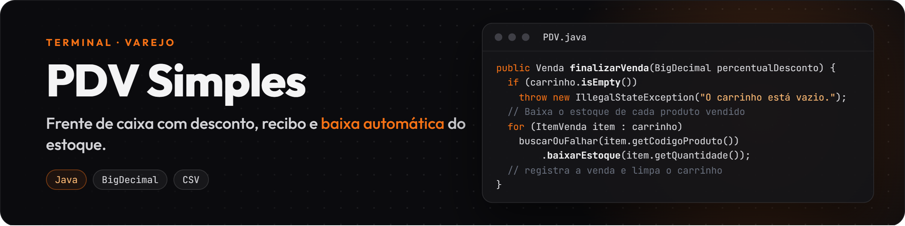
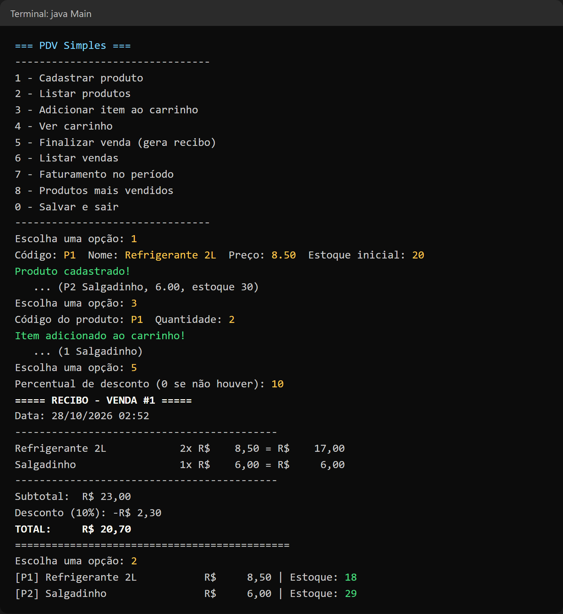

Frente de caixa que roda no terminal: cadastro de produtos, carrinho, desconto, recibo, baixa automática do estoque e relatórios de vendas. Feito em Java puro, sem banco de dados: os dados ficam em arquivos `.csv`.



## O que este projeto mostra

- **Dinheiro sem erro de arredondamento:** preços, subtotais e descontos com `BigDecimal`.
- **Histórico que não muda:** o preço do produto fica gravado no item da venda; se o preço mudar depois, as vendas antigas continuam certas.
- **Estoque sempre atualizado:** a venda finalizada baixa o estoque, e o sistema não deixa vender mais do que tem.
- **Persistência simples:** ao sair pelo menu, tudo é salvo em `dados/*.csv` (`java.nio`).

## Contexto

No caixa, rapidez e conta certa não podem falhar. O PDV Simples simula o "motor" de um caixa comercial direto no terminal, sem interface gráfica pesada: o operador cadastra produtos, monta o carrinho, aplica desconto e recebe o recibo, enquanto o estoque é atualizado na hora.

## Funcionalidades

| Opção | O que faz |
| :--- | :--- |
| 1 | Cadastrar produto (código, nome, preço e estoque inicial) |
| 2 | Listar produtos com estoque |
| 3 | Adicionar item ao carrinho (barra se não houver estoque) |
| 4 | Ver o carrinho com subtotais |
| 5 | Finalizar a venda com desconto percentual e gerar o recibo |
| 6 | Listar as vendas feitas |
| 7 | Faturamento num período |
| 8 | Produtos mais vendidos |
| 0 | Salvar em `.csv` e sair |

## Estrutura

```text
src/
├── Main.java          # menu e leitura do teclado
├── PDV.java           # regras do caixa: carrinho, venda, estoque, relatórios
├── Produto.java
├── ItemVenda.java     # guarda o preço do momento da venda
├── Venda.java         # itens, desconto, total e recibo
└── ArquivoUtil.java   # leitura e gravação dos .csv
```

## Como rodar

Com o JDK 17 ou mais novo instalado:

```bash
cd src
javac -d ../out *.java
cd ../out
java Main
```

## Roteiro de teste

1. `1`: cadastre `P1`, Refrigerante 2L, 8.50, estoque 20.
2. `1`: cadastre `P2`, Salgadinho, 6.00, estoque 30.
3. `3`: adicione 2 unidades de `P1` ao carrinho.
4. `3`: adicione 1 unidade de `P2`.
5. `4`: veja o carrinho com os subtotais.
6. `5`: finalize com 10% de desconto e veja o recibo (total R$ 20,70).
7. `2`: confira que o estoque caiu para 18 e 29.
8. `0`: salve e saia. **Sempre saia por aqui**: é essa opção que grava os arquivos `.csv`.

| Situação | O que fazer |
| :--- | :--- |
| `javac: comando não encontrado` | Instale o JDK e coloque-o no PATH. |
| `Could not find or load main class Main` | Rode `java Main` dentro da pasta `out`, não da `src`. |
| "Estoque insuficiente" | É proposital: o sistema não vende mais do que tem em estoque. |
| "O carrinho está vazio" | Adicione itens com a opção 3 antes de finalizar. |

## Próximos passos

- [ ] Testes automatizados (JUnit) para desconto, arredondamento e baixa de estoque
- [ ] Maven e GitHub Actions para rodar os testes a cada envio
- [ ] Guardar produtos e vendas no MySQL, em vez de arquivos `.csv`
- [ ] Recibo em PDF e busca de produto por nome
